# SPS: UML architecture

Song Practice Studio, drawn from the code at `v0.0.65` (mps-core `v0.14.0`). Fifteen [Mermaid](https://mermaid.js.org/) diagrams; they render on GitHub and in VS Code's Markdown preview. Mermaid has no native UML component or deployment diagram, so those are flowcharts with the UML meaning in the caption.

What is shared with VPS is shown as **mps-core** and not redrawn here: see [Shared core](shared-core.md) and `core/wiki/uml.md`. The workspace-level picture of both apps is `MPS/wiki/uml-architecture.md`; the VPS counterpart of this page is `VPS/wiki/uml.md`. When code and a diagram disagree, the code wins; fix the diagram.

What makes SPS different from VPS, and so what this page spends its diagrams on: **stems** (a dynamic set of up to six per song), **chords** (detected, editable, transposable, with a capo), **tab sync** (a Guitar Pro tab placed on the recording), **bass tab**, and **no pitch analysis of takes** (takes are only loudness-normalised).

| # | Diagram | Kind | Question |
|---|---|---|---|
| 1 | Layers and processes | Deployment | What runs, and where does each concern live? |
| 2 | Screens and panels | Component | Which page shows which components? |
| 3 | Domain model | Class | Song, stems, chords, takes, tab, bass tab, lyrics. |
| 4 | Data on disk | Component | Which file holds which part of the model? |
| 5 | Player store | Class | How is the player state split into slices? |
| 6 | AudioEngine | Class | How does a dynamic `Map` of stems differ from VPS's fixed trio? |
| 7 | Chord data flow | Component | From stems to detected chords, edits, display and export. |
| 8 | Tab sync data flow | Component | From a Guitar Pro file to bar lines on the waveform. |
| 9 | Rust backend | Class | Which modules make up the shell, who calls the sidecar? |
| 10 | Python sidecar | Component | Which commands exist, which module serves each? |
| 11 | Process a song | Sequence | Five stages from import to library. |
| 12 | Align a tab | Sequence | Import, parse, align, edit bars. |
| 13 | Record a take | Sequence | Recording and loudness normalisation. |
| 14 | Transpose | Sequence | Pitch-shifted stems swapped in place. |
| 15 | Tab states | State | The tab store's status machine. |

---

## 1. Layers and processes (deployment view)

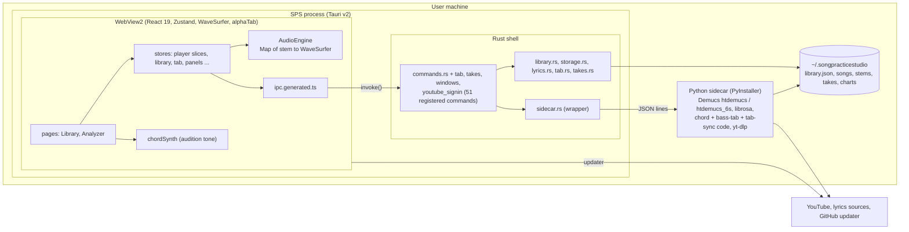

## 2. Screens and panels (component view)

Two pages in a route held in `App.tsx`. The analyzer is a stack of **panels**; `chords`, `lyrics` and `takes` are in the panel store (visible, ordered, detachable), and the waveform area is collapsible but never unmounted because it owns the engine's containers.

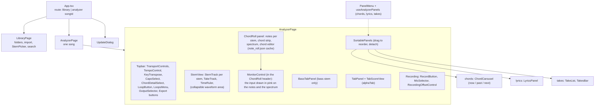

## 3. Domain model (class view)

TypeScript types are in `src/lib/types.ts`, `tabScore.ts` and `bassTab.ts`; the Rust twins in `library.rs`, `tab.rs`, `takes.rs` and `lyrics.rs` (camelCase over the wire). Note: SPS's `Song` has `stems` and `hasChords` where VPS has `kind` and an artist.

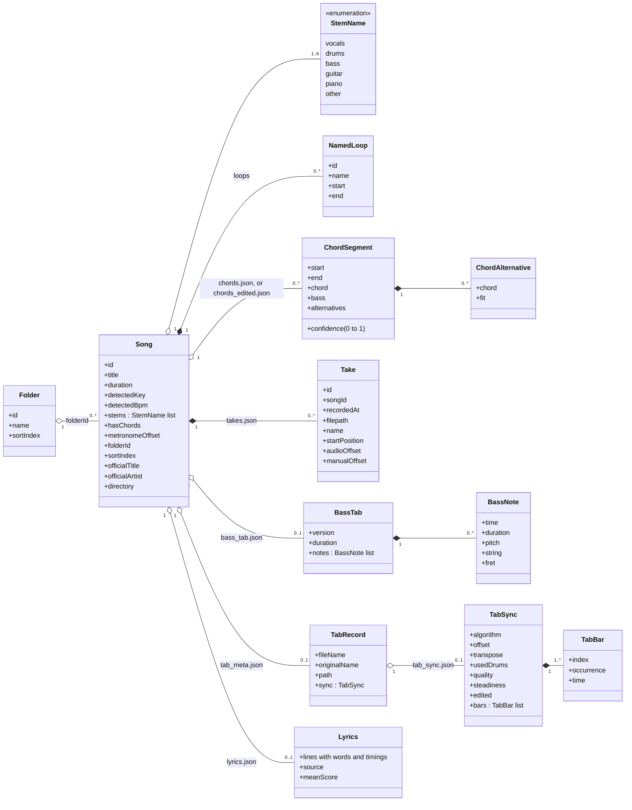

## 4. Data on disk (component view)

`~/.songpracticestudio` (see `storage.rs`; it was `~/.songanalyzer` before a rename). Chords the user corrected live in a separate file that wins when present, so re-detecting never destroys the detected result unasked.

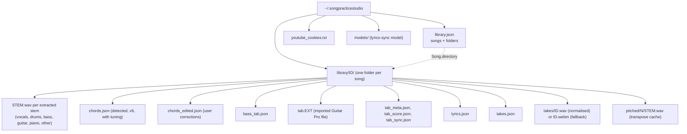

## 5. Player store (class view)

One `usePlayerStore` built from seven slices in `src/stores/player/`. The chords slice is only presentation preferences (capo, detail level, a revision counter); the chord data itself is fetched per song, not held in the store.

```mermaid
classDiagram
    direction TB
    class PlayerStore {
        <<usePlayerStore>>
    }
    class TransportSlice {
        isPlaying, currentTime, playbackRate, duration
        loopStart, loopEnd, isLooping
        play() pause() seek() stop()
    }
    class MixerSlice {
        stem volumes, mute, solo
        transpose, isTransposing
        setTranspose()
    }
    class TimelineSlice {
        minPxPerSec, scrollTime
        punchIn, punchOut, loops
        metronomeOffset
    }
    class DevicesSlice {
        audio + output devices
        recordingOffsets, usedLatencyFallback
        applyCalibration()
    }
    class RecordingSlice {
        isRecording, isSavingTake, count-in
        startRecording() stopRecording()
    }
    class TakesSlice {
        takes, shown, active, muted, soloed, gains
        fetchTakes() deleteTake() renameTake()
    }
    class ChordsSlice {
        capo, chordsRevision, chordDetail
        setCapo() bumpChordsRevision() setChordDetail()
    }
    class Helpers {
        <<files>>
        audioMix.ts (pure gain and mix maths)
        prefs.ts (localStorage)
        singletons.ts (engine, recorder, session)
    }
    PlayerStore *-- TransportSlice
    PlayerStore *-- MixerSlice
    PlayerStore *-- TimelineSlice
    PlayerStore *-- DevicesSlice
    PlayerStore *-- RecordingSlice
    PlayerStore *-- TakesSlice
    PlayerStore *-- ChordsSlice
    PlayerStore ..> Helpers
```

## 6. AudioEngine (class view)

The structural difference from VPS: stems are a `Map<string, WaveSurfer>` because the set differs per song. The first stem loaded (vocals when present) becomes the **master clock**.

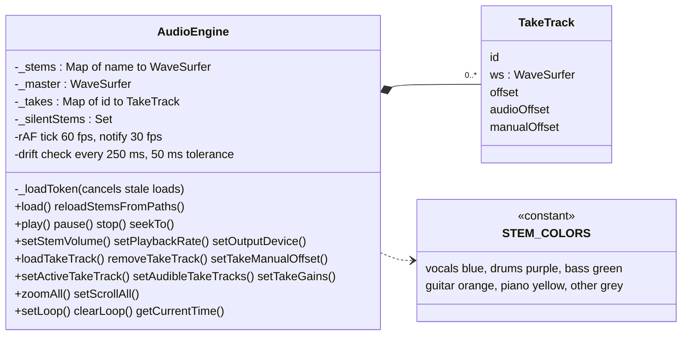

## 7. Chord data flow (component view)

Detection is done once, at import (or on demand), by the sidecar; everything after that is cheap, pure TypeScript.

```mermaid
flowchart LR
    subgraph sidecar["Python sidecar (processor.py)"]
        direction TB
        S1["stems without drums and vocals<br/>(else the original file)"]
        S2["beat windows (librosa beat track)<br/>or fixed 1 s grid"]
        S3["chroma templates: 24 triads, 7 / maj7 / min7,<br/>slash bass from the bass stem"]
        S4["Viterbi (switch cost + key prior)"]
        S1 --> S2 --> S3 --> S4
    end
    S4 --> CJ["chords.json v6<br/>segments + confidence + alternatives + tuning"]
    UE["user corrections<br/>(ChordRoll: strip, handles, +, editor)"] --> CEJ["chords_edited.json (wins when present)"]
    CJ --> RS["read_song_chords"]
    CEJ --> RS
    RS --> FE["lib/chords.ts useChordSegments"]

    subgraph pure["Pure TypeScript in lib/"]
        direction TB
        CN["chordNames: transpose, simplify by detail<br/>(Easy / Medium / Advanced)"]
        KC["keyChords: chords of the key"]
        CV["chordVoicing: shapes to play<br/>(chords shown shifted by transpose minus capo)"]
        SE["sections: group repeating chord blocks<br/>(cannot yet tell verse from chorus)"]
        CE["chordEdit: set, split, join, move, add"]
        CC["chordChart: text chart export"]
    end
    FE --> pure
    pure --> UI["ChordCarousel, ChordRoll (strip, editor, spectrum),<br/>ExportChartButton, LoopsMenu sections"]
    UI --> SY["chordSynth (audition tone)"]
    UE -. "save_chord_edits" .-> CEJ
    RD["redetect_song_chords"] -. "detect_chords, deletes edits" .-> sidecar
```

## 8. Tab sync data flow (component view)

The Guitar Pro file is parsed **in the WebView** (alphaTab) into a compact `TabScore`; the sidecar never reads Guitar Pro files. The alignment places bar lines on the recording with chroma plus kick/snare features and a banded DTW, and the user can then drag bars.

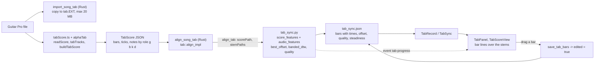

## 9. Rust backend (class view)

`sidecar.rs` and `windows.rs` are thin wrappers over core crates, as in VPS. SPS owns two modules VPS does not have: `tab.rs` (tab storage and alignment) and `takes.rs` (take list persistence).

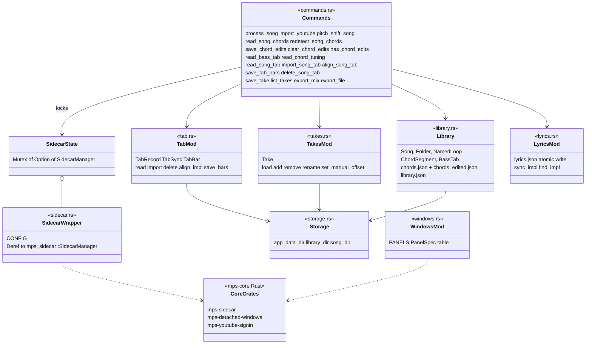

## 10. Python sidecar (component view)

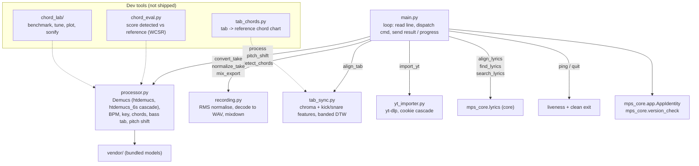

## 11. Process a song (sequence view)

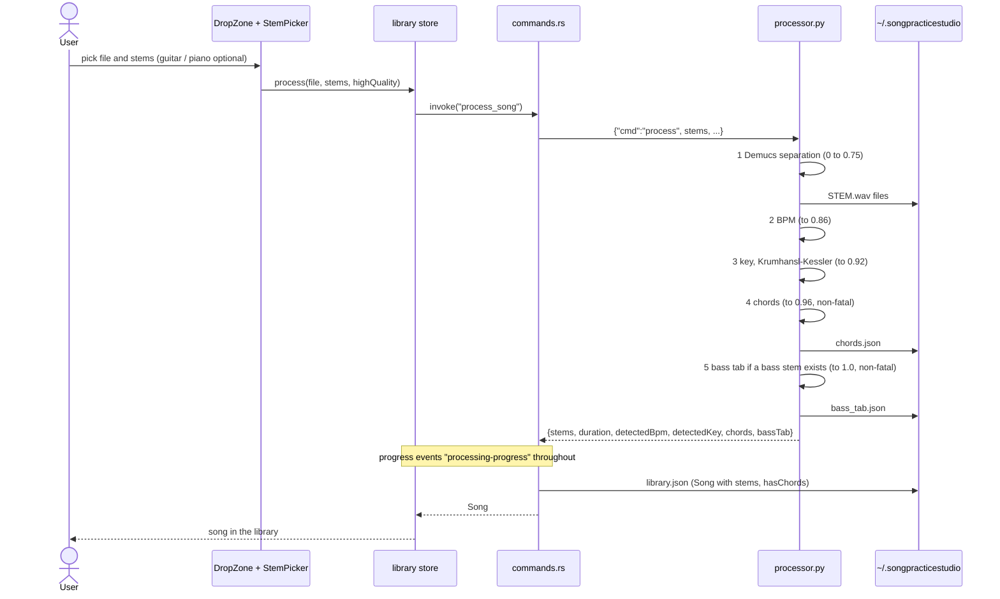

## 12. Align a tab (sequence view)

Importing a tab aligns it straight away; the **Align** button runs the same alignment again later. The Guitar Pro file is read in the WebView (alphaTab), never in the sidecar.

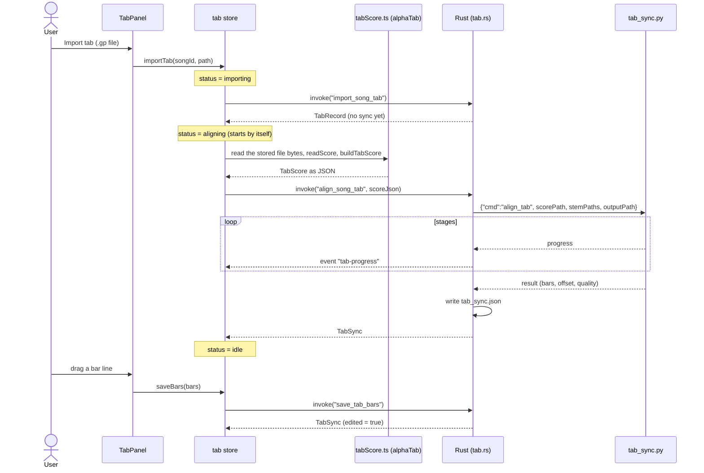

## 13. Record a take (sequence view)

SPS records and stores a take but does not analyse its pitch; the sidecar only normalises loudness against the vocals stem.

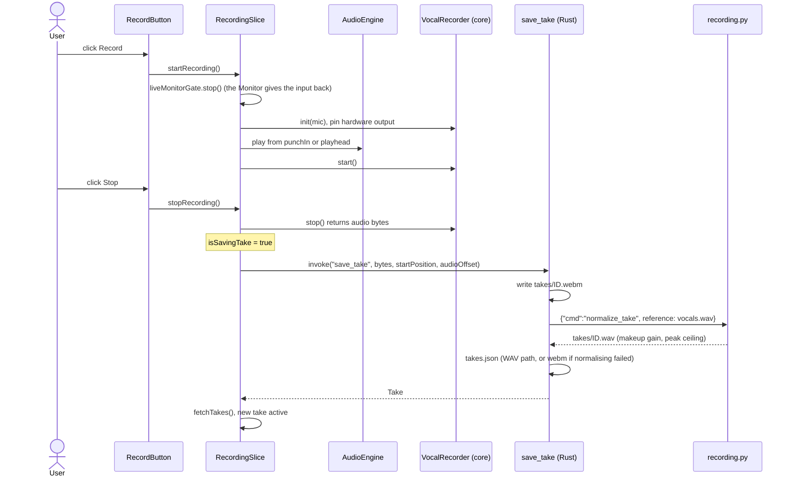

## 14. Transpose (sequence view)

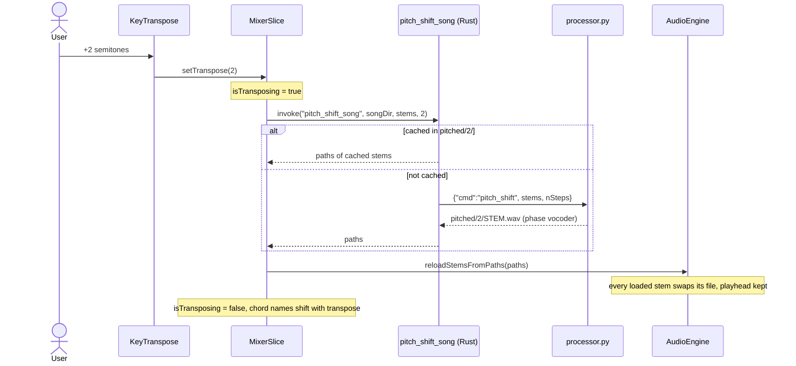

## 15. Tab states (state view)

`TabStatus` in the tab store. Any failure ends in `Error` (the message is shown, and after a failed import the stored record is read again); `clearError` returns to `Idle`.

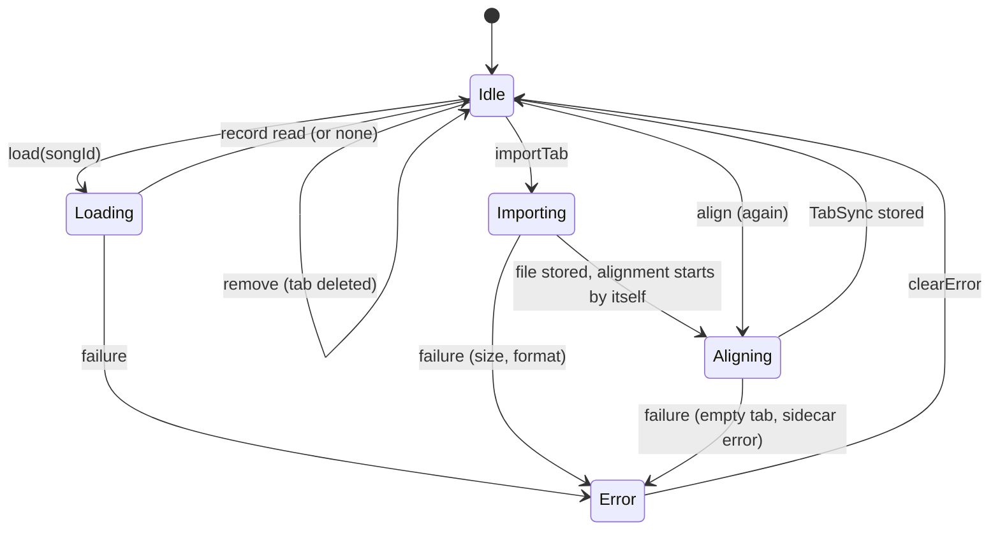

## 16. Monitor: the input against the song (component view)

The Monitor in the chord roll listens to the input chosen in the mic menu and never records. `liveMonitorGate` (in the player store's `singletons.ts`) exists because the player store cannot import the monitor's store, which imports the player store; `startRecording` stops the monitor through it first.

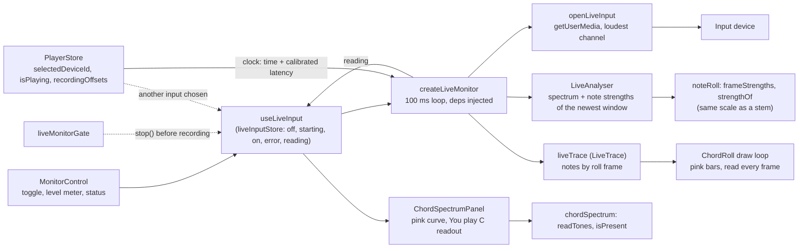

---

## Keeping this current

- Change the matching diagram in the same commit as a structural change (new slice, command, sidecar `cmd`, module, or on-disk file).
- Names in diagrams are searchable in the code. Drift risks: the slice list (5), the registered-command count (1; `generate_handler!` in `lib.rs`), the sidecar command table (10), the processing stages and progress ranges (11, mirrored from `CLAUDE.md`), `ANALYZER_PANELS` (2).
- Every diagram was parsed with Mermaid 11.4.1 (`mermaid.parse`) on 2026-10-18; layout was not viewed. There is no CI check, so re-preview after editing.
